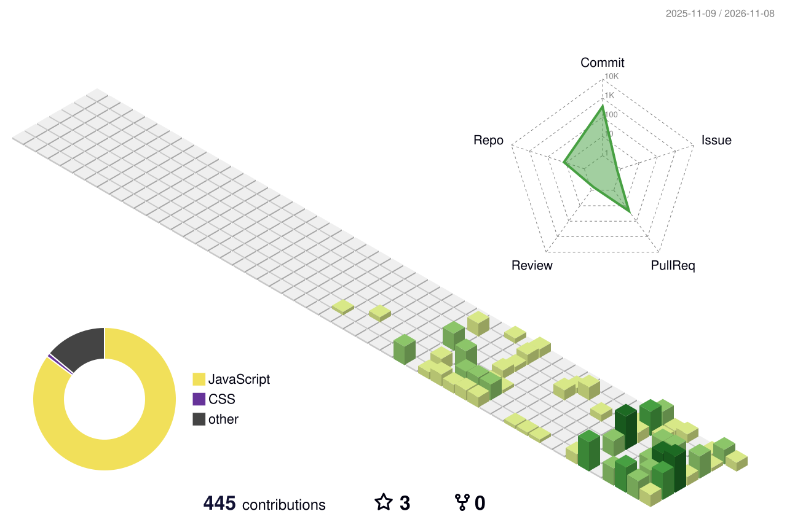

  

<h3 align="center">
  Aspiring Cruise Ship IT Officer · Full-Stack Developer · Artist
</h3>

<h2><strong> About Me </strong></h2>

<h5 align="center">
I'm a third-year <strong>Bachelor of Science in Information Systems</strong> student at <strong>La Verdad Christian College</strong>. I enjoy building practical systems, exploring new technologies, and finding creative ways to solve problems. My friends know me as the quirky and funny introvert of the group. I believe that difficult problems are invitations to learn: try, investigate, improve, and keep moving forward. Life never really stops teaching us—and apparently, neither do mysterious bugs.
</h5>

 

 

## Current Focus

- Developing a Laravel-based café information system to support daily operations
- Strengthening web and mobile development skills with React and React Native
- Learning website hosting and administration through cPanel
- Building automated workflows with n8n to streamline repetitive tasks

 

---

  <table width="100%">
    <tr>
      <td colspan="2" align="center"><h2>Technical Skills</h2></td>
    </tr>
    <tr>
      <td width="25%"><strong>Frontend &amp; Mobile</strong></td>
      <td align="center">
        <kbd></kbd>
        <kbd></kbd>
        <kbd></kbd>
        <kbd></kbd>
        <kbd></kbd>
        <kbd></kbd>
        <kbd></kbd>
        <kbd></kbd>
        <kbd></kbd>
        <kbd></kbd>
        <kbd></kbd>
      </td>
    </tr>
    <tr>
      <td width="25%"><strong>Backend &amp; Databases</strong></td>
      <td align="center">
        <kbd></kbd>
        <kbd></kbd>
        <kbd></kbd>
        <kbd></kbd>
        <kbd></kbd>
        <kbd></kbd>
        <kbd></kbd>
        <kbd></kbd>
        <kbd></kbd>
        <kbd></kbd>
      </td>
    </tr>
    <tr>
      <td width="25%"><strong>Platforms &amp; Integrations</strong></td>
      <td align="center">
        <kbd></kbd>
        <kbd></kbd>
        <kbd></kbd>
        <kbd></kbd>
        <kbd></kbd>
         <kbd></kbd>
        <kbd></kbd>
        <kbd></kbd>
        <kbd></kbd>
        <kbd></kbd>
      </td>
    </tr>
    <tr>
      <td width="25%"><strong>Design &amp; Media</strong></td>
            <td align="center">
        <kbd></kbd>
        <kbd></kbd>
        <kbd></kbd>
        <kbd></kbd>
      </td>
    </tr>
  </table>

 

## Beyond the Keyboard

- Traditional art
- Photography
- Music streaming
- Reading non-fiction books

 

## Certificates & Badges

  
  &nbsp;&nbsp;
  
  &nbsp;&nbsp;
  

## GitHub Stats

<h2>Coding Activity</h2>

  
  

<h2>Let's Connect</h2>

  Open to conversations about software development, information systems,
  and creative projects.

  
  &nbsp;&nbsp;
  
  &nbsp;&nbsp;
  

  
    Thanks for visiting—stay curious, keep creating, and remember to commit before experimenting.
  

